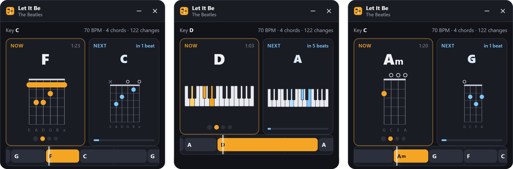
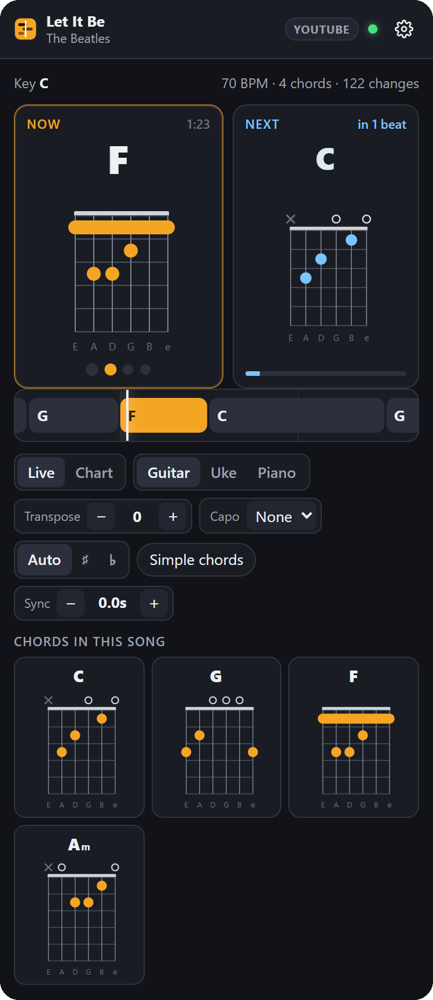
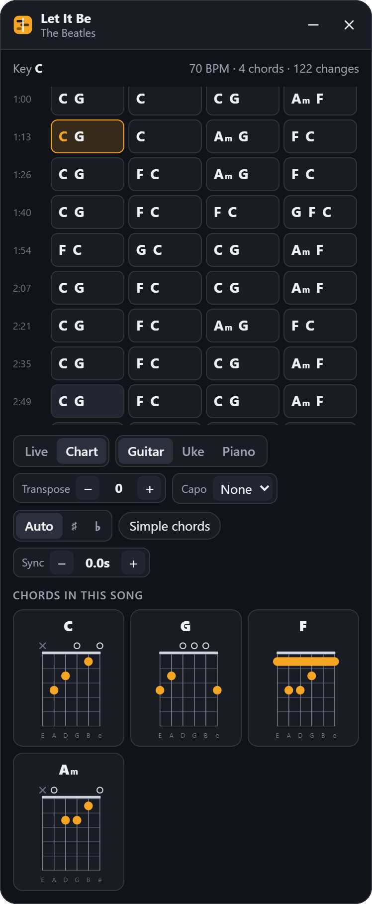

# ChordCue

**Live chords for whatever you're playing.** Open a song on YouTube, YouTube Music, Spotify or SoundCloud, and ChordCue shows the chord being played right now and counts you in to the next one. It stays in step with the music, so you can play along on guitar, ukulele or piano.



## What it does

- **Follows what's playing.** The panel detects the song in your tab and stays in sync with the page's own player: pause, seek or skip, and the chords follow. While an ad plays, the chords wait.
- **Shows the next chord before it arrives.** The **Next** card counts down the beats to the change, and a lane of upcoming chords slides past a playhead.
- **Diagrams for three instruments.** Guitar (open and barre shapes), ukulele and piano, for all 14 chord types it recognizes in every key. Click a diagram to see another shape.
- **Transpose and capo.** Move the song into a key that suits your voice, or set a capo and see which shapes to play. It also suggests the capo fret that gives the easiest open chords.
- **Chart of the whole song.** Every bar with its chords. The current bar is highlighted, and clicking any bar jumps the song there.
- **Spotify desktop app too.** A companion window follows the Spotify app on Windows and can seek it.
- **Runs on your own PC.** A local server finds the chords with AI models on your GPU. A new song takes about 20 seconds, and after that it opens instantly.

| Live view | Chart view | Minimized |
|:---:|:---:|:---:|
|  |  |  |

It works in any Chromium browser: Brave, Chrome, Edge or Opera.

```
extension/   the browser extension (Manifest V3, no build step)
chordcue/    the analysis server (FastAPI)
docs/        README screenshots
tools/       icon generator
tests/       backend tests (extension tests live in extension/tests)
```

## Install

ChordCue isn't in any extension store. You download it from this page and run it on your own computer.

### What you need

- **Windows 10 or 11.** The setup scripts and the Spotify desktop window are Windows-only; see [Other systems](#other-systems) below.
- **[Python 3.12](https://www.python.org/downloads/).** When installing, tick **Add python.exe to PATH**.
- **ffmpeg.** In a terminal, run:

  ```bash
  winget install Gyan.FFmpeg
  ```

  Then open a new terminal so it's on your PATH.
- **About 5 GB of free disk space** for Python packages and models.
- **A Chromium browser:** Brave, Chrome, Edge or Opera.
- **An NVIDIA GPU is optional.** With one, the server also separates the instruments from the vocals before finding chords, which is slightly more accurate. Without one, it skips that step, and a song still takes about 20 seconds on a 6-core CPU.

### Steps

1. **Get the code.** Either clone it:

   ```bash
   git clone https://github.com/chinown/ChordCue.git
   ```

   Or click **Code → Download ZIP** at the top of this page and unzip it.
2. **Double-click `setup.bat`** in the ChordCue folder. It creates a Python environment in `.venv` and installs PyTorch and the other requirements from `requirements.txt`. That's about 3 GB, downloaded once.
3. **Double-click `start-server.bat`** and leave its window open while you play music. On the first run it downloads the chord, beat and separation models (about 150 MB). It's ready when it prints `ChordCue server on http://127.0.0.1:8765`.
4. **Load the extension in your browser:**
   - Open `brave://extensions` (or `chrome://extensions`, `edge://extensions`, `opera://extensions`).
   - Turn on **Developer mode**.
   - Click **Load unpacked** and pick the **`extension`** folder inside ChordCue.
   - Pin ChordCue to the toolbar. Its popup shows a green "Server on" when everything is connected.

**To update later,** run `git pull` (or download the ZIP again). Then run `setup.bat` again if `requirements.txt` changed, and click the reload icon on ChordCue in your browser's extensions page.

### Other systems

The server should also run on macOS and Linux, but this hasn't been tested. Install ffmpeg with your package manager, then from the ChordCue folder:

```bash
python3.12 -m venv .venv
```

```bash
.venv/bin/pip install torch==2.11.0 torchaudio==2.11.0
```

```bash
.venv/bin/pip install -r requirements.txt
```

```bash
.venv/bin/python -m chordcue.server
```

On Linux with an NVIDIA GPU, add `--index-url https://download.pytorch.org/whl/cu128` to the torch install. The Spotify desktop window needs Windows; everything else works the same.

## Using it

- **In the browser:** play a song on YouTube, YouTube Music, open.spotify.com or SoundCloud and the panel appears. Music is analyzed automatically. For other YouTube videos you get a **Get chords** button (change this in the toolbar popup). Drag the panel by its header, shrink it to a pill with **–**, and toggle it with **Alt+Shift+C**.
- **Spotify desktop app:** click the toolbar icon, then **Open chords window**. The window follows the Spotify app through Windows' media controls, the same info shown in the volume flyout. Click the lane or a bar to seek Spotify.
- **Controls:**
  - **Transpose:** moves the song up or down by semitones.
  - **Capo:** shows shapes relative to the capo. **Try capo N** suggests the fret with the easiest open shapes.
  - **♯/♭:** spelling, where Auto follows the key.
  - **Simple chords:** reduces 7ths, 6ths and similar chords to plain major and minor.
  - **Sync:** nudges the chords earlier or later. Use it if a Spotify track's chords run early or late.
  - Click a diagram in **Chords in this song** to cycle through other shapes.

Transpose, capo and sync are remembered per song. Instrument, view and notation are remembered for all songs.

## How it works

1. **Find the audio.** YouTube and SoundCloud audio is downloaded with yt-dlp. Spotify audio is DRM-protected, so the server reads the track's title, artist and length and downloads the matching upload from YouTube. It prefers YouTube's official "Artist - Topic" uploads, which are the same master recording, so the timing lines up.
2. **Separate the instruments** with [Demucs](https://github.com/facebookresearch/demucs) (htdemucs). Chords are recognized from bass + "other" (guitars, keys, synths), without the vocals and drums. This step only runs when a GPU is present.
3. **Track beats and bars** with [Beat This!](https://github.com/CPJKU/beat_this).
4. **Recognize chords** with [BTC](https://github.com/jayg996/BTC-ISMIR19), a transformer that knows 170 chord types. Its frame-by-frame guesses are averaged per beat and smoothed with a Viterbi pass, so chords change on beats (mostly on downbeats) instead of flickering. The key and a capo suggestion come from the recognized chords.
5. The extension's background worker fetches the result, and the panel keeps it in sync with the page's own player.

Results are cached in `data/songs/<id>/sheet.json`. The downloaded audio is deleted after analysis unless `CHORDCUE_KEEP_AUDIO=1` is set.

### Server settings (environment variables)

| Variable | Default | |
|---|---|---|
| `CHORDCUE_SEPARATE` | `auto` | `1`/`0` to force stem separation on or off (`auto` = only with CUDA) |
| `CHORDCUE_DEVICE` | auto | `cuda` or `cpu` |
| `CHORDCUE_DATA` | `./data` | where analyzed songs are stored |
| `CHORDCUE_MAX_DURATION` | `900` | longest song accepted, in seconds |

`start-server.bat --port 9000` changes the port. If you do, also set the address under **Settings → Server address** in the popup.

## Tests

```bash
.venv/Scripts/python tests/test_backend.py
```

```bash
.venv/Scripts/deno run extension/tests/theory.test.js
```

The extension test checks that every guitar and ukulele shape it can draw sounds exactly its chord, for all 14 chord types in all 12 keys.

## Limits

- Chords are an estimate. Dense mixes, heavy distortion or unusual harmony can throw them off, so check by ear.
- Spotify sync depends on finding the same recording on YouTube. If a song's intro differs, use **Sync**.
- The Spotify web player and SoundCloud adapters read their players through the page. They haven't been tested logged in, so if either site changes its layout, the panel may not find the song.
- The server only accepts requests from the extension, or from tools that send no web origin, and only listens on localhost.

## License

ChordCue is released under the [MIT License](LICENSE) © 2026 Davi Chen. You can use, copy, change and share it, as long as you keep the copyright notice.

`chordcue/chords/btc_model.py` is adapted from BTC and keeps its own MIT notice (© 2019 Jonggwon Park).

## Credits

BTC chord model © 2019 Jonggwon Park (MIT; model code adapted in `chordcue/chords/btc_model.py`). Beat This! © CPJKU (MIT). Demucs © Meta (MIT). yt-dlp (Unlicense). Inspired by the play-along view of anychord.net.
