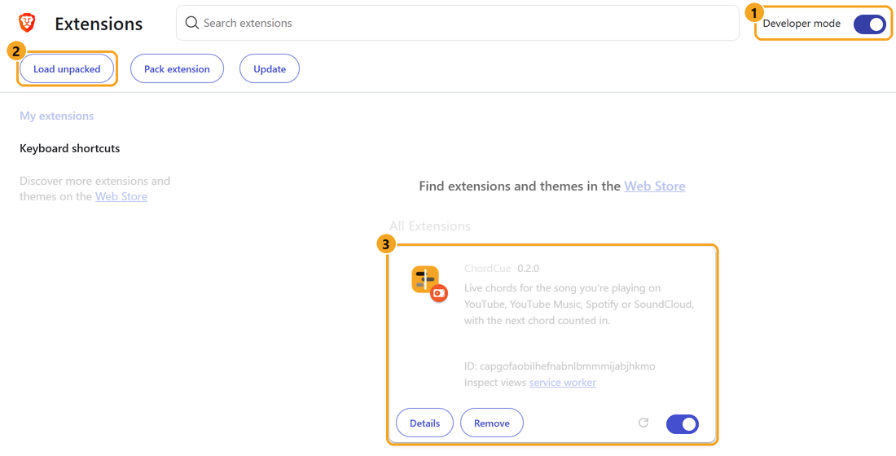

# ChordCue

**Live chords for whatever you're playing.** Play a song on YouTube, YouTube Music, Spotify or SoundCloud and click the ChordCue icon. A side panel opens next to the page, shows the chord being played right now, and counts you in to the next one. It stays in step with the music, so you can play along on guitar, ukulele or piano.


## What it does

- **One click, one panel.** Clicking the ChordCue icon opens the side panel, and it starts working straight away. Nothing appears on any page until you open it.
- **Follows what's playing.** The panel picks up the song in your tab and stays in sync with the page's own player: pause, seek or skip, and the chords follow. While an ad plays, the chords wait.
- **Shows the next chord before it arrives.** The **Next** card counts down the beats to the change, and a lane of upcoming chords slides past a playhead.
- **Diagrams for three instruments.** Guitar (open and barre shapes), ukulele and piano, for all 14 chord types it recognizes in every key. Click a diagram to see another shape.
- **Transpose and capo.** Move the song into a key that suits your voice, or set a capo and see which shapes to play. It also suggests the capo fret that gives the easiest open chords.
- **Chart of the whole song.** Every bar with its chords. The current bar is highlighted, and clicking any bar jumps the song there.
- **Spotify desktop app too.** When no tab is playing a song, the same panel follows the Spotify app on Windows, and can seek it.
- **Runs on your own PC, with nothing to start.** A small server starts by itself when you turn on your computer and runs in the background with no window, using about 60 MB of memory while idle. The AI models load only while a song is being analyzed (about 20 seconds per new song; after that it opens instantly) and are unloaded after 5 quiet minutes, so they don't hold your memory or graphics card while you do other things.

| Live view | Chart view |
|:---:|:---:|
|  |  |

## Install

You need **Windows 10 or 11** and **Brave, Chrome, Edge or Opera**. It takes about 15 minutes, mostly downloading, and you only do it once.

### The easy way: the installer

1. **[Download Install-ChordCue.bat](https://github.com/chinown/ChordCue/releases/latest/download/Install-ChordCue.bat).** If your browser warns about this kind of file, choose **Keep**.
   If that link doesn't work, click [Install-ChordCue.bat](Install-ChordCue.bat) in the file list instead, then the download button (⤓) at the top right.
2. **Double-click it.** If Windows says it protected your PC, click **More info → Run anyway**. Press **Enter** to start. If it asks to install Python or ffmpeg, type **Y** and press **Enter**.
3. **Follow the page it opens.** When it's done, a page opens in your browser and walks you through adding the extension, which takes about a minute.

The installer puts ChordCue in a `ChordCue` folder in your user folder and sets it to start by itself, in the background, whenever you turn on your computer. From then on there's nothing to start: play a song and click the ChordCue icon in your browser. To update ChordCue, run the installer again; your settings and songs are kept.

### Or set it up by hand

1. **Download ChordCue.** Click the green **Code** button at the top of this page, then **Download ZIP**. Unzip it somewhere you'll keep it, like your Documents folder.
2. **Double-click `setup.bat`** in the ChordCue folder. If Python or ffmpeg is missing, it asks to install them: type **Y** and press Enter. Then it downloads everything else (up to 3 GB). Wait until it says **Setup finished**.
3. **Double-click `start-server.bat`** to start ChordCue for now. A window opens; it's ready when it says `ChordCue server on http://127.0.0.1:8765`. (Once the extension is set up, tick **Start ChordCue when Windows starts** in the panel's settings and you won't need this window again.)
4. **Add the extension to your browser.** Type `brave://extensions` in the address bar and press Enter (in Chrome it's `chrome://extensions`, in Edge `edge://extensions`). Turn on **Developer mode** (1), click **Load unpacked** (2) and choose the **`extension`** folder inside the ChordCue folder. ChordCue appears in the list (3). Then click the puzzle-piece icon in the toolbar and pin ChordCue.

   

5. **Play a song and click the ChordCue icon.** The chords panel opens next to the page. A song's first play takes about 20 seconds to work out the chords. After that, it's instant.

Then open the panel's settings (the **gear**) and tick **Start ChordCue when Windows starts**. From then on, just click the icon.

### If something isn't working

- **Red dot in the panel, or "ChordCue isn't running":** double-click **ChordCue** on your desktop (or `start-server.bat` in the ChordCue folder). If this happens after every restart, tick **Start ChordCue when Windows starts** in the panel's settings.
- **"Reload this tab to connect ChordCue":** refresh the page (F5).
- **The chords run early or late:** nudge them with **Sync** in the panel.

## Using it

Click the **ChordCue icon** (or press **Alt+Shift+C**) and the side panel opens beside the page. It decides what to follow by itself:

1. **The song in the tab you're looking at:** YouTube, YouTube Music, open.spotify.com or SoundCloud.
2. **Otherwise, the last tab that had a song**, so you can switch tabs while the music keeps playing.
3. **Otherwise, the Spotify desktop app.** It reads Windows' media controls, the same info shown in the volume flyout.

A song it hasn't seen before is analyzed as soon as it's picked up. The source shows in the panel's header (YouTube, Spotify app, and so on). Click the lane or a bar in the chart to jump there; this works on YouTube, YouTube Music, SoundCloud and the Spotify app. The **gear** opens settings: **Start ChordCue when Windows starts**, the server address, and **Analyze this song again**.

If your browser has no side panel, the icon opens the same panel in a small window that follows the tab you clicked from.

- **Controls:**
  - **Transpose:** moves the song up or down by semitones.
  - **Capo:** shows shapes relative to the capo. **Try capo N** suggests the fret with the easiest open shapes.
  - **♯/♭:** spelling, where Auto follows the key.
  - **Simple chords:** reduces 7ths, 6ths and similar chords to plain major and minor.
  - **Sync:** nudges the chords earlier or later. Use it if a Spotify track's chords run early or late.
  - Click a diagram in **Chords in this song** to cycle through other shapes.

Transpose, capo and sync are remembered per song. Instrument, view and notation are remembered for all songs.

## More setup details

- **What `setup.bat` installs:** Python 3.12 and ffmpeg through winget (only if missing, and only after you say yes), then a private Python environment in `.venv` with PyTorch and the packages in `requirements.txt`, and the chord model. The beat and separation models (about 150 MB) download the first time the server analyzes a song and are cached in your user folder (`.cache`). Everything else stays inside the ChordCue folder.
- **Graphics card:** with an NVIDIA card, setup installs the GPU build of PyTorch and the server also separates instruments from vocals before finding chords, which is slightly more accurate. Without one it installs the much smaller CPU build and skips that step; a song still takes about 20 seconds on a 6-core CPU.
- **Disk space:** about 5 GB with an NVIDIA card, much less without.
- **Using git instead of the ZIP:**

  ```bash
  git clone https://github.com/chinown/ChordCue.git
  ```

- **Updating:** run `Install-ChordCue.bat` again (or `git pull`, or download the ZIP again and run `setup.bat`), then click the reload icon on ChordCue in your browser's extensions page.
- **Running in the background:** the Startup shortcut runs `pythonw -m chordcue.service`, which has no window and writes its log to `data/server.log`. Only one copy runs at a time. Turn it on or off with the panel's checkbox, or from the ChordCue folder:

  ```bash
  .venv\Scripts\python -m chordcue.autostart on
  ```

  (`off` and `status` work too.) To stop ChordCue until the next restart, end `pythonw.exe` in Task Manager.
- **Uninstalling:** untick **Start ChordCue when Windows starts** (or run the command above with `off`), remove ChordCue on your browser's extensions page, then delete the `ChordCue` folder and the **ChordCue** desktop shortcut.

### Other systems

The server should also run on macOS and Linux, but this hasn't been tested. Install ffmpeg with your package manager, then from the ChordCue folder:

```bash
python3.12 -m venv .venv
```

```bash
.venv/bin/pip install torch==2.11.0 torchaudio==2.11.0
```

```bash
.venv/bin/pip install -r requirements.txt
```

```bash
.venv/bin/python -m chordcue.server
```

On Linux with an NVIDIA GPU, add `--index-url https://download.pytorch.org/whl/cu128` to the torch install. The Spotify desktop app support needs Windows; everything else works the same.

### What's in this repo

```
extension/   the browser extension (Manifest V3, no build step)
chordcue/    the analysis server (FastAPI)
docs/        README screenshots
tools/       icon generator
tests/       backend tests (extension tests live in extension/tests)
```

## How it works

1. **Find the audio.** YouTube and SoundCloud audio is downloaded with yt-dlp. Spotify audio is DRM-protected, so the server reads the track's title, artist and length and downloads the matching upload from YouTube. It prefers YouTube's official "Artist - Topic" uploads, which are the same master recording, so the timing lines up.
2. **Separate the instruments** with [Demucs](https://github.com/facebookresearch/demucs) (htdemucs). Chords are recognized from bass + "other" (guitars, keys, synths), without the vocals and drums. This step only runs when a GPU is present.
3. **Track beats and bars** with [Beat This!](https://github.com/CPJKU/beat_this).
4. **Recognize chords** with [BTC](https://github.com/jayg996/BTC-ISMIR19), a transformer that knows 170 chord types. Its frame-by-frame guesses are averaged per beat and smoothed with a Viterbi pass, so chords change on beats (mostly on downbeats) instead of flickering. The key and a capo suggestion come from the recognized chords.
5. The extension's background worker fetches the result, and the panel keeps it in sync with the page's own player.

Results are cached in `data/songs/<id>/sheet.json`. The downloaded audio is deleted after analysis unless `CHORDCUE_KEEP_AUDIO=1` is set.

### Server settings (environment variables)

| Variable | Default | |
|---|---|---|
| `CHORDCUE_SEPARATE` | `auto` | `1`/`0` to force stem separation on or off (`auto` = only with CUDA) |
| `CHORDCUE_DEVICE` | auto | `cuda` or `cpu` |
| `CHORDCUE_DATA` | `./data` | where analyzed songs are stored |
| `CHORDCUE_MAX_DURATION` | `900` | longest song accepted, in seconds |
| `CHORDCUE_WORKER_IDLE` | `300` | seconds the analysis worker (and its models) stays loaded after the last song |

`start-server.bat --port 9000` changes the port. If you do, also set the address under the panel's **gear → Server address**.

## Tests

```bash
.venv/Scripts/python tests/test_backend.py
```

```bash
.venv/Scripts/deno run extension/tests/theory.test.js
```

The extension test checks that every guitar and ukulele shape it can draw sounds exactly its chord, for all 14 chord types in all 12 keys.

## Limits

- Chords are an estimate. Dense mixes, heavy distortion or unusual harmony can throw them off, so check by ear.
- Spotify sync depends on finding the same recording on YouTube. If a song's intro differs, use **Sync**.
- The Spotify web player and SoundCloud adapters read their players through the page. They haven't been tested logged in, so if either site changes its layout, the panel may not find the song.
- The server only accepts requests from the extension, or from tools that send no web origin, and only listens on localhost.

## License

ChordCue is released under the [MIT License](LICENSE) © 2026 Davi Chen. You can use, copy, change and share it, as long as you keep the copyright notice.

`chordcue/chords/btc_model.py` is adapted from BTC and keeps its own MIT notice (© 2019 Jonggwon Park).

## Credits

BTC chord model © 2019 Jonggwon Park (MIT; model code adapted in `chordcue/chords/btc_model.py`). Beat This! © CPJKU (MIT). Demucs © Meta (MIT). yt-dlp (Unlicense). Inspired by the play-along view of anychord.net.
